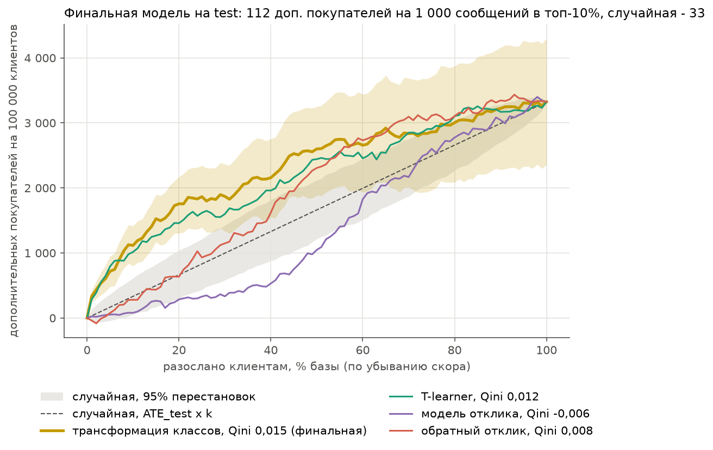
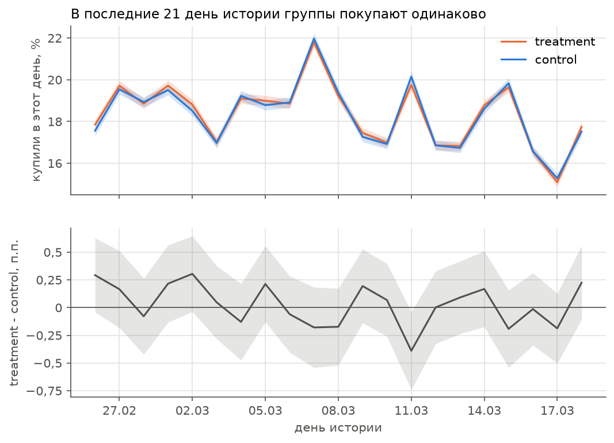
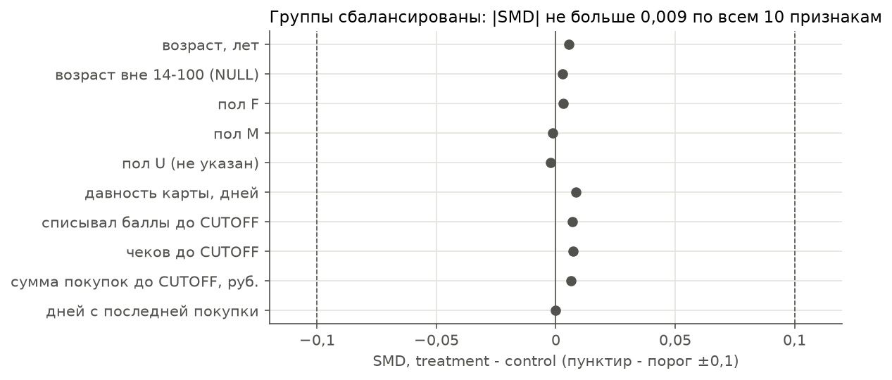
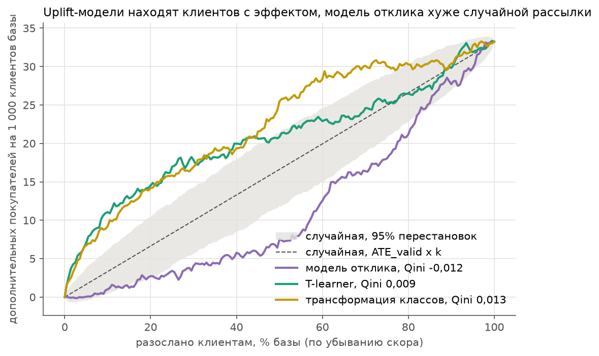
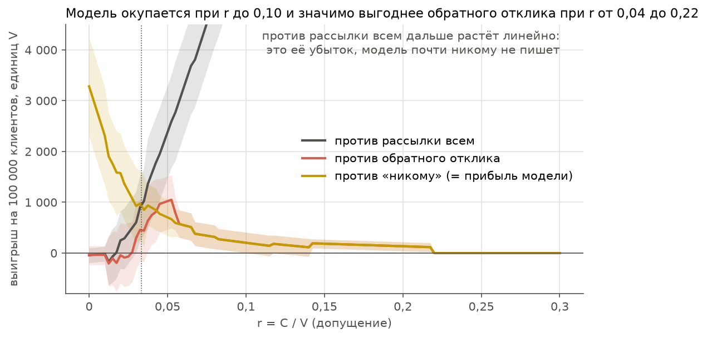
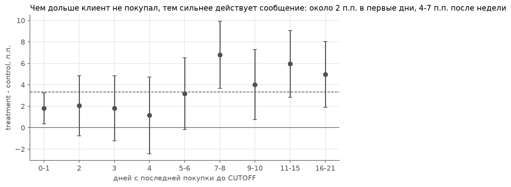

# Uplift-моделирование на X5 RetailHero

X5 провела рандомизированную коммуникацию с клиентами: половине отправили, половине нет, и отметили, была ли
после этого покупка. Я разбираю эксперимент как аналитик: работает ли коммуникация в среднем, у кого она меняет
решение о покупке и сколько дополнительных покупателей даёт рассылка по uplift-модели на 1 000 сообщений
по сравнению со случайной рассылкой и с рассылкой по модели отклика.

Результат: коммуникация в среднем работает, +3,32 п.п. покупателей (от 2,90 до 3,75), то есть 33 дополнительных
покупателя на 1 000 сообщений при рассылке всем. На test рассылка топ-10% клиентов по uplift-модели даёт
112 дополнительных покупателей на 1 000 сообщений (от 80 до 142), случайная рассылка - 33, модель отклика - 8.
Модель отклика хуже случайной и на valid, и на test: в её верхнем дециле 95% клиентов покупают и без сообщения.
Простое правило «писать тем, кто реже покупает» (обратный отклик) - сильный бейзлайн: модель обгоняет его
в топ-10, 20 и 30% (+84, +56 и +24 на 1 000 сообщений), но по Qini разница не значима (+0,008, от -0,001 до 0,016).
По экономике: рассылка всем окупается, пока сообщение стоит меньше среднего эффекта, то есть дешевле 3,3%
ценности дополнительного покупателя. Таргетинг по модели окупается до 10%: интервал его прибыли выше нуля при
таком отношении цены к ценности. Начиная с 3,3% модель значимо выгоднее рассылки всем, а от 4 до 22% - и обратного
отклика. Цену сообщения и ценность покупателя я не знаю, поэтому показываю зависимость от их отношения.

Финальную модель (трансформация классов) выбрало правило ничьей, записанное в плане до обучения. У выбранной
модели больше разброс по seed (размах Qini 0,0055 против 0,0017 у T-learner), а logloss почти как у константы
(0,6921 против 0,6926). Правило после этого я не менял. На test она и T-learner не различаются.



Дополнительные покупатели на 100 000 клиентов при рассылке первым k% по скору, test; полоса - бутстреп-интервал финальной модели.

| на test | Qini | доп. на 1 000, топ-10% | топ-20% | топ-30% |
|---|---|---|---|---|
| трансформация классов (финальная) | 0,015 (0,009 ... 0,022) | 112 (80 ... 142) | 88 (65 ... 109) | 62 (45 ... 79) |
| T-learner | 0,012 (0,005 ... 0,019) | 102 (69 ... 129) | 73 (51 ... 94) | 53 (34 ... 71) |
| обратный отклик | 0,008 (0,002 ... 0,014) | 28 (2 ... 57) | 32 (14 ... 52) | 38 (22 ... 55) |
| модель отклика | -0,006 (-0,012 ... -0,001) | 8 (-5 ... 21) | 14 (3 ... 25) | 11 (1 ... 23) |
| случайная рассылка | 0 | 33 (24 ... 43) | 33 (24 ... 43) | 33 (24 ... 43) |

Интервалы - парный бутстреп по клиентам test внутри групп, 1 000 повторов. План анализа - метрики, бейзлайны,
правило выбора модели и однократная оценка на test - записан в [docs/plan.md](docs/plan.md) до обучения моделей
и заморожен отдельным коммитом до первого обращения к test.

## Как устроено решение

1. Проверка данных. Все агрегаты и проверки написаны на SQL и выполняются в DuckDB. Размеры таблиц и доли сходятся
   с описанием датасета: 200 039 клиентов в эксперименте, target 0,62, treatment 0,50. Дублей нет, все клиенты
   эксперимента есть в истории покупок. `transaction_id` уникален только в паре с `client_id`: 28 значений
   встречаются у двух разных клиентов, поэтому чек - это пара. Даты в `clients` на 3 часа позже, чем в purchases,
   сдвигаю их назад: после сдвига в момент `first_redeem_date` есть чек со списанием баллов у 98,8% клиентов,
   в момент `first_issue_date` - первая покупка у 98,0%. Возраст вне 14-100 лет у 1 779 клиентов, в витрине
   он будет NULL. Дату коммуникации и окно target по данным не установить:
   история обрывается на полном дне 2019-03-18, а `first_redeem_date` доходит до 2019-11-20, то есть `clients`
   содержит события после коммуникации.
2. Проверка эксперимента. SRM нет: 99 981 в treatment против 100 058 в control, хи-квадрат против 50/50 даёт p = 0,86.
   Группы сбалансированы по 10 признакам из `clients` и истории покупок: все |SMD| меньше 0,01 при пороге 0,1.
   Расхождений между группами в конце истории не обнаружено: доля покупавших в последние 3 и 7 дней различается
   на +0,01 и +0,24 п.п. при MDE 0,61 п.п. (alpha = 0,05, мощность 80%), по отдельным дням MDE около 0,5 п.п.
   По описанию датасета purchases - история до коммуникации, `CUTOFF` оставил 2019-03-18. Разведочно: первое
   списание баллов после `CUTOFF` в treatment чаще на 0,39 п.п. (от 0,11 до 0,67), поэтому этой даты в признаках
   нет. Коммуникация в среднем работает: купили 63,65% treatment и 60,33% control, разница +3,32 п.п.
   (от 2,90 до 3,75, бутстреп даёт то же). При рассылке всем это 33 дополнительных покупателя на 1 000 сообщений.

   

   Доля купивших в каждый из последних 21 дня истории и разница групп с 95%-интервалом.

   

   |SMD| каждого признака между treatment и control, пунктир - порог 0,1.
3. Признаки. Витрина на SQL: одна строка на клиента эксперимента, 46 признаков из purchases до `CUTOFF` и из
   `clients`. По окнам 7, 14, 30 дней и всей истории - частота, сумма, средний чек, баллы начисленные и списанные,
   доля чеков со списанием, число магазинов и товаров. Отдельно - давность последней и первой покупки, тренд
   последних 14 дней против предыдущих, возраст, пол, давность карты, списывал ли баллы до `CUTOFF` и через сколько
   дней после выдачи карты. Признаки строятся только из данных до `CUTOFF`: это гарантирует фильтр по дате, проверил
   пересчётом шести признаков для 300 случайных клиентов из сырых строк purchases - совпали. Target и treatment
   признаки не используют, поэтому витрину строю сразу на всех клиентах без утечки между частями разбиения. Баланс
   признаков по группам (|SMD| не больше 0,009) с этим согласуется, но сам по себе отсутствие утечки не доказывает:
   признак после коммуникации, на который она не повлияла, тоже был бы сбалансирован. Признаки, где ненулевое
   значение у меньше 0,5% клиентов, убираю: под правило попали только начисления экспресс-баллов за 7, 14 и 30 дней
   (акций с начислением после 2019-03-10 не было).
4. Модели. Три модели на LightGBM: модель отклика (вероятность покупки при сообщении, только treatment-часть train),
   T-learner (разность вероятностей покупки в treatment и control) и трансформация классов. Гиперпараметры подбирал
   5-fold CV внутри train по logloss, valid - только для сравнения подходов, test не трогал. Метрики uplift написал
   сам и сверил с scikit-uplift: Qini-кривая, Qini-коэффициент и uplift@k совпадают. На valid обе uplift-модели лучше
   случайной рассылки: при рассылке топ-10% T-learner даёт 114 дополнительных покупателей на 1 000 сообщений
   (от 83 до 145), трансформация классов - 96 (от 67 до 128), случайная рассылка - 33. Модель отклика хуже случайной:
   Qini -0,012 (от -0,018 до -0,006). В её верхнем дециле покупают 95,9% treatment и 94,9% control - эти клиенты
   купят и без сообщения. Разница между двумя uplift-моделями не значима и меньше разброса по пяти seed, поэтому
   по правилу ничьей из плана выбрал трансформацию классов: одна модель вместо двух. У неё слабое место:
   по logloss ранняя остановка оставила 16 деревьев, logloss 0,6921 против 0,6926 у константы.

   

   Дополнительные покупатели на 1 000 клиентов базы при рассылке первым x% по скору модели, valid.

   После valid добавил бейзлайн «обратный отклик» - рассылку по возрастанию вероятности покупки: на valid эффект
   оказался сосредоточен в нижних децилях модели отклика. На valid он почти догоняет uplift-модели по Qini (0,008),
   и значимо они лучше только в топ-10%. Бейзлайн записал в план до открытия test.
5. Оценка на test. Перед первым обращением к test заморозил в плане финальную модель, бейзлайны, метрики,
   бутстреп и экономику и закоммитил скрипт оценки. Всё на test считается одним запуском
   `python -m src.evaluate_test`, перед расчётом скрипт проверяет, что модели из файлов дают на valid ровно
   оценённые скоры. Средний эффект на test в точности равен эффекту на valid: стратифицированное разбиение
   при равных размерах частей даёт одинаковые числа клиентов и покупателей в каждой группе. Результат на test
   не хуже valid: Qini финальной модели 0,015 против 0,013, в топ-10% - 112 против 96. Обратный отклик в топ-10%
   на test - 28 (от 2 до 57), ниже случайной рассылки, но в пределах шума; на valid нижние децили модели отклика
   давали 4,5-5,6 п.п. эффекта. После запуска на test исправлены только ошибки отображения в ноутбуке 05,
   цифры не менялись.

   Почему против обратного отклика Qini не значим, а uplift@k значим. Qini интегрирует всю кривую, а все кривые
   сходятся в точке «слать всем». Обратный отклик догоняет модель ко второй половине базы, и разница набирается
   только в начале списка, куда и смотрит uplift@k. Для решения о бюджете смотрю не на них, а на прибыль при
   заданном отношении цены сообщения к ценности покупателя.
6. Экономика. Прибыль от рассылки первым k клиентов в единицах ценности покупателя V: дополнительные покупатели
   минус r x отправлено, где r = C / V - отношение цены сообщения к ценности покупателя (допущение, сетка от 0
   до 0,30). Долю k для каждого r выбираю на valid, прибыль считаю на test. Сравниваю с тремя бейзлайнами: рассылка
   всем, обратный отклик и «не писать никому» (прибыль 0). Рассылка всем окупается при r < ATE = 0,0332. Интервал
   прибыли модели выше нуля при r от 0 до 0,10 и ещё в отдельных точках до 0,2175, где она пишет 1-3% базы
   и зарабатывает около 120-190 V на 100 000 клиентов. При r до 0,01 модель пишет 97% базы и от рассылки всем
   не отличается. С r = 0,0325 она значимо выгоднее рассылки всем, при r от 0,0375 до 0,2175 - и обратного отклика.
   При r = 0,05 модель пишет 14% базы и получает около 700 V на 100 000 клиентов, а обратный отклик с долей,
   выбранной на valid, уходит в минус: выигрыш +1 023 (от 464 до 1 511). Интервалы взяты из того же единственного
   запуска на test, пересчитывать ничего не пришлось.

   

   Выигрыш финальной модели на 100 000 клиентов в единицах V против трёх бейзлайнов, доля рассылки выбрана на valid, test.

   Четыре типа клиентов оценил на уровне всей базы, поклиентно они не наблюдаются. Без допущений доля
   переубеждаемых - от 3,3% до 39,7%. При допущении, что отрицательной реакции на сообщение нет: 60,3% купят и так,
   3,3% переубеждаемых, 36,3% не купят в любом случае. Проверить это допущение по данным нельзя.
7. Сегменты, разведка на valid. Описание клиентов, которых выбирает модель, без объяснения почему. В топ-10%
   финальной модели медиана 10 чеков против 15 у всех, сумма 2 834 руб. против 6 097, давность карты 273 дня
   против 487, медиана возраста 58 лет против 45, доля чеков со списанием баллов 14,8% против 7,1%. Uplift в этой
   группе 9,6 п.п. В топ-10% модели отклика - 51 чек, 15 тысяч руб., uplift 1,0 п.п. Простой сегмент по давности
   последней покупки: у покупавших в последние два дня эффект 1,8 п.п., у не покупавших неделю и больше - 4-7 п.п.,
   до 9,6 п.п. верхнего дециля модели он не дотягивает.

   

   Наблюдаемый uplift по группам давности последней покупки, valid, пунктир - средний эффект.

## Как запустить

Нужен Python 3.13, на macOS ещё `brew install libomp` для LightGBM.

```bash
python3 -m venv .venv && .venv/bin/pip install -r requirements.txt
```

Скачать данные (около 680 МБ) и перевести purchases в parquet, несколько минут:

```bash
.venv/bin/python -m src.data
```

Разбиение train/valid/test, несколько секунд:

```bash
.venv/bin/python -m src.split
```

Витрина признаков в `data/features.parquet`, около 15 секунд (её же пересобирает ноутбук 03):

```bash
.venv/bin/python -m src.features
```

Подбор гиперпараметров и обучение моделей, около 7 минут, лог в `artifacts/train.log`:

```bash
.venv/bin/python -m src.models
```

Оценка на test одним запуском, около 3 минут, результат в `artifacts/test_results.json`:

```bash
.venv/bin/python -m src.evaluate_test
```

Ноутбуки выполняются по порядку: 01 около 3 минут, 02 и 03 - секунды, 04 около 2 минут (бутстреп), 05 - секунды.

```bash
for nb in notebooks/0*.ipynb; do .venv/bin/jupyter nbconvert --to notebook --execute --inplace "$nb"; done
```

Тесты:

```bash
.venv/bin/python -m pytest tests
```

## Структура

- `docs/plan.md` - план анализа, зафиксированный до обучения моделей.
- `sql/staging.sql` - вьюхи над исходными файлами, даты `clients` сдвинуты на 3 часа назад.
- `sql/quality.sql` - ключи, дубли, пропуски, суммы чеков, возраст, даты, сдвиг на 3 часа и его обратная проверка.
- `sql/experiment.sql` - размеры групп, ковариаты для баланса, покупки по дням, списания после `CUTOFF`, target.
- `sql/features.sql` - витрина признаков и её проверки: строки, NULL, диапазоны, баланс по группам.
- `src/config.py` - пути, сид, доли разбиения, `CUTOFF`, сдвиг дат `clients` и границы возраста.
- `src/db.py` - подключение к DuckDB и запуск именованных запросов из `sql/`.
- `src/data.py` - скачивание данных и перевод purchases в parquet.
- `src/split.py` - разбиение со стратификацией по treatment x target в `data/split.parquet`.
- `src/features.py` - сборка витрины признаков в `data/features.parquet`.
- `src/models.py` - модель отклика, T-learner и трансформация классов, CV внутри train, скоры на valid.
- `src/uplift.py` - Qini-кривая, Qini-коэффициент, площадь, uplift@k, бутстреп, перестановки, прирост и выбор доли.
- `src/evaluate_test.py` - вся оценка на test одним запуском: метрики, разности, кривые, экономика.
- `src/stats.py` - SRM, SMD, интервалы для разницы долей и средних, бутстреп.
- `src/plots.py` - общее оформление графиков: цвета групп, белый фон, сохранение в `images/`.
- `tests/test_split.py` - доли разбиения, стратификация и воспроизводимость.
- `tests/test_stats.py` - статистические функции на примерах с известным ответом.
- `tests/test_uplift.py` - метрики uplift на игрушечных примерах и сверка с scikit-uplift.
- `notebooks/01_data_quality.ipynb` - таблица колонок и отчёт о качестве данных.
- `notebooks/02_experiment.ipynb` - SRM, баланс групп, конец истории покупок, средний эффект.
- `notebooks/03_features.ipynb` - описание признаков, проверки витрины и независимая сверка.
- `notebooks/04_models.ipynb` - подбор, метрики на valid, децили, устойчивость по seed, выбор финальной модели.
- `notebooks/05_test.ipynb` - результаты на test, экономика, сегменты на valid.
- `images/` - графики для README, их сохраняют ноутбуки 02, 04 и 05.
- `artifacts/` - выбранные параметры, модели seed 42, скоры на valid и результаты test, в git не входят.

## Ограничения

- Все клиенты датасета покупали в последние 22 дня истории. Похоже на отбор активных клиентов, поэтому выводы
  относятся только к ним.
- `clients` выгружен не раньше 2019-11-20: `first_redeem_date` доходит до этой даты. Поэтому `age` и `gender` -
  состояние на момент выгрузки, а не на момент коммуникации.
- Примерно в 3% чеков сумма чека и сумма строк расходятся больше чем на 5 руб., причина не установлена.
  В признаках используется сумма чека `purchase_sum`.
- В соревновании были ещё `products.csv` (справочник товаров) и `uplift_test.csv` (клиенты без target), но в источнике
  scikit-uplift их нет. Без справочника признаки по категориям товаров не строю.

## Данные и библиотеки

Датасет X5 RetailHero Uplift Modeling (X5 Retail Group, хакатон 2019,
https://ods.ai/competitions/x5-retailhero-uplift-modeling). Файлы скачиваются по ссылкам из `sklift.datasets.fetch_x5`.
Данные в репозиторий не входят.

- [DuckDB](https://duckdb.org) - MIT
- [pandas](https://pandas.pydata.org), [NumPy](https://numpy.org), [SciPy](https://scipy.org), [scikit-learn](https://scikit-learn.org) - BSD-3-Clause
- [PyArrow](https://arrow.apache.org) - Apache-2.0
- [LightGBM](https://github.com/microsoft/LightGBM) - MIT
- [scikit-uplift](https://github.com/maks-sh/scikit-uplift) - MIT, только для сверки метрик
- [Matplotlib](https://matplotlib.org) - Matplotlib License (на основе PSF)
- [Jupyter](https://jupyter.org) - BSD-3-Clause
- [pytest](https://pytest.org) - MIT
